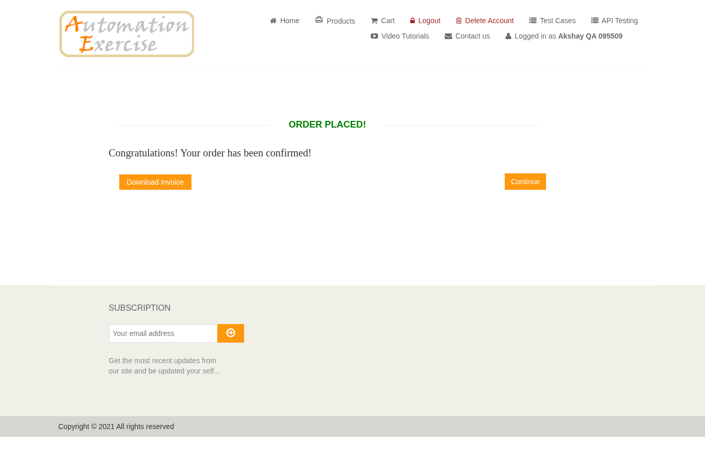
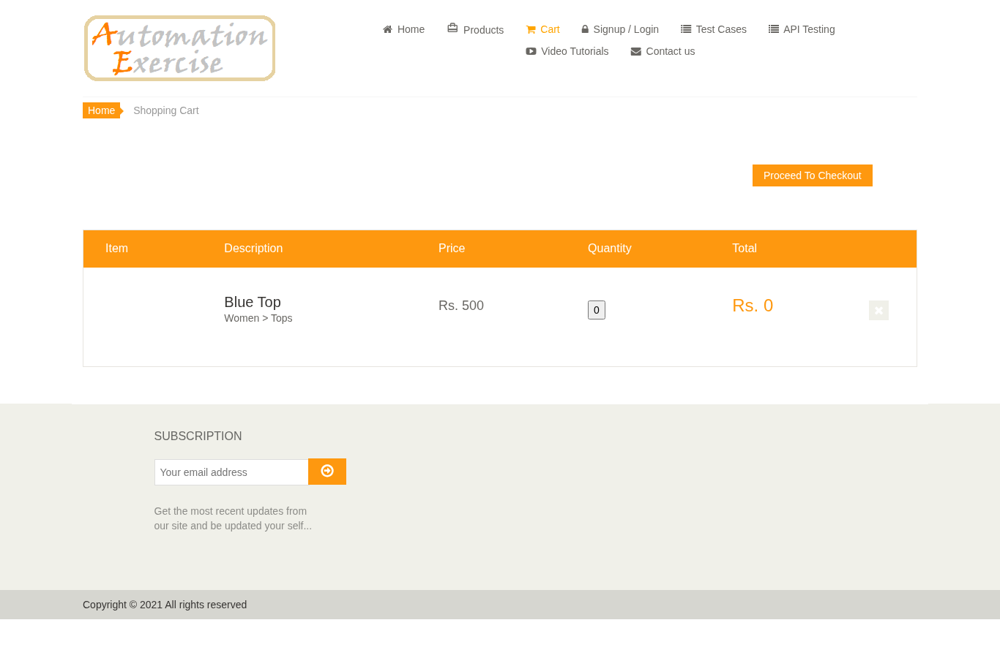
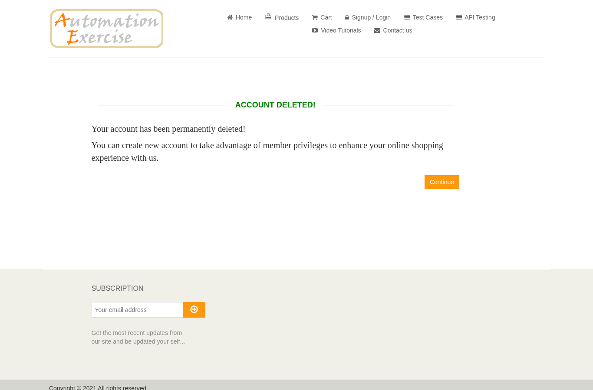
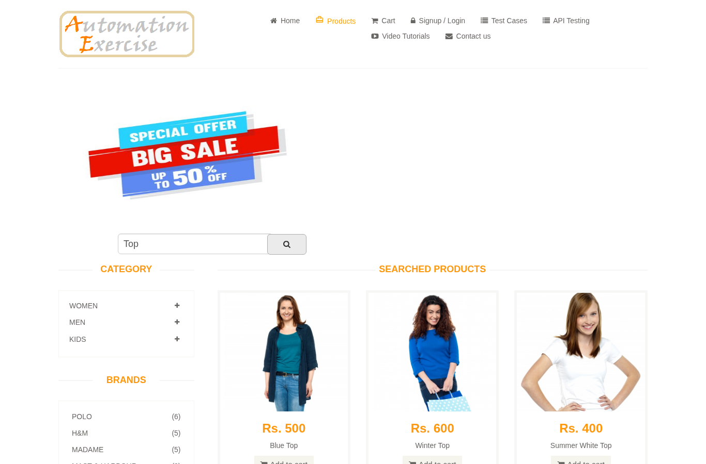
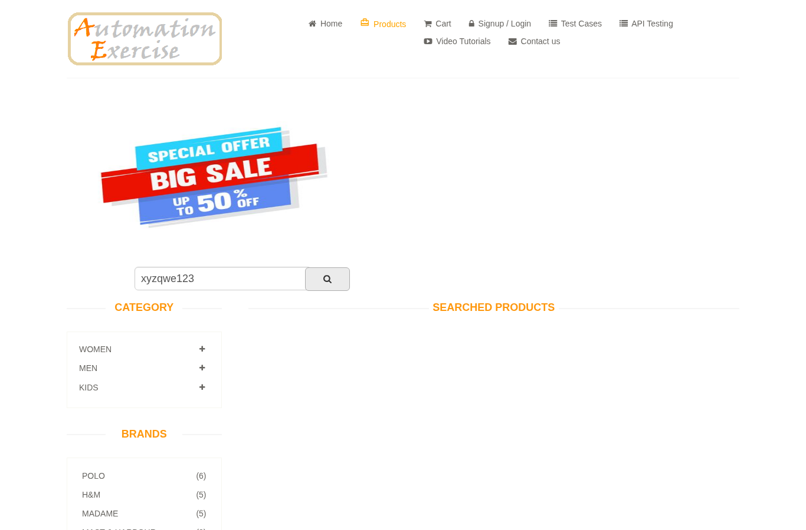

# Bug Reports

These six findings come from the supplied execution record dated 2026-10-27. They have not been rerun for this revision. “Open” is the local portfolio status, not a ticket status acknowledged by Automation Exercise.

**Original severity scale:** Critical – potential money/security impact; High – business-rule concern; Medium – behaviour concern; Low – usability. The original ratings are retained, but no real financial loss or payment exploit was demonstrated.

| Bug ID | Summary | Severity | Priority | Test Case |
|---|---|---|---|---|
| BUG-001 | Cart accepts negative quantity and shows negative total (Rs. -1500) | Critical | P1 | TC_CART_005 |
| BUG-002 | Order is placed with invalid card details (no payment validation) | Critical | P1 | TC_CHK_004 |
| BUG-003 | Product can be added with quantity 0 | High | P2 | TC_CART_004 |
| BUG-004 | No password strength policy on signup - 1 character password accepted | High | P2 | TC_REG_004 |
| BUG-005 | Search 'Top' returns unrelated shirts | Medium | P3 | TC_SEARCH_001 |
| BUG-006 | No 'no results' message when search finds nothing | Low | P3 | TC_SEARCH_002 |

---

## BUG-001: Cart accepts negative quantity and shows negative total (Rs. -1500)

| Field | Detail |
|---|---|
| Severity / Priority | Critical / P1 |
| Status | Open |
| Environment | Chromium-based browser; version unresolved, desktop 1366×768, https://automationexercise.com |
| Linked test case | [TC_CART_005](../test-cases/test-cases.md) |
| Reported on | 2026-10-27 |

**Steps to reproduce**

1. Open https://automationexercise.com/product_details/1
2. Set Quantity to -3
3. Click Add to cart
4. Open Cart

**Expected result:** Product is not added; quantity must be 1 or more

**Actual result:** Product added with quantity -3; total shows Rs. -1500. No refund or financial exploit was tested.

**Evidence**

---

## BUG-002: Order is placed with invalid card details (no payment validation)

| Field | Detail |
|---|---|
| Severity / Priority | Critical / P1 |
| Status | Open |
| Environment | Chromium-based browser; version unresolved, desktop 1366×768, https://automationexercise.com |
| Linked test case | [TC_CHK_004](../test-cases/test-cases.md) |
| Reported on | 2026-10-27 |

**Steps to reproduce**

1. Login and add any product
2. Proceed to payment
3. Card no. 12, CVC 1, Expiry 99/1990
4. Click Pay and Confirm Order

**Expected result:** Payment is rejected with field-level errors (card length, CVC length, valid month 01-12, future year)

**Actual result:** 'ORDER PLACED!' shown for card 12, CVC 1 and expiry 99/1990. Other invalid combinations were not established by this case.

**Evidence**

---

## BUG-003: Product can be added with quantity 0

| Field | Detail |
|---|---|
| Severity / Priority | High / P2 |
| Status | Open |
| Environment | Chromium-based browser; version unresolved, desktop 1366×768, https://automationexercise.com |
| Linked test case | [TC_CART_004](../test-cases/test-cases.md) |
| Reported on | 2026-10-27 |

**Steps to reproduce**

1. Open product 1
2. Set Quantity to 0
3. Add to cart
4. Open Cart

**Expected result:** Add to cart is blocked with a validation message

**Actual result:** 'Added!' popup shown; cart contains item with quantity 0 and total Rs. 0

**Evidence**

---

## BUG-004: No password strength policy on signup - 1 character password accepted

| Field | Detail |
|---|---|
| Severity / Priority | High / P2 |
| Status | Open |
| Environment | Chromium-based browser; version unresolved, desktop 1366×768, https://automationexercise.com |
| Linked test case | [TC_REG_004](../test-cases/test-cases.md) |
| Reported on | 2026-10-27 |

**Steps to reproduce**

1. Start signup with a new email
2. Enter password '1'
3. Fill other fields, click Create Account

**Expected result:** Signup blocked; message lists password rules (min length, mix of characters)

**Actual result:** Account created successfully with password '1'

**Evidence**

---

## BUG-005: Search 'Top' returns unrelated shirts

| Field | Detail |
|---|---|
| Severity / Priority | Medium / P3 |
| Status | Open |
| Environment | Chromium-based browser; version unresolved, desktop 1366×768, https://automationexercise.com |
| Linked test case | [TC_SEARCH_001](../test-cases/test-cases.md) |
| Reported on | 2026-10-27 |

**Steps to reproduce**

1. Open Products
2. Search 'Top'

**Expected result:** Only products related to 'Top'

**Actual result:** 14 results include 'Little Girls Mr. Panda Shirt' and 'Colour Blocked Shirt – Sky Blue'

**Evidence**

---

## BUG-006: No 'no results' message when search finds nothing

| Field | Detail |
|---|---|
| Severity / Priority | Low / P3 |
| Status | Open |
| Environment | Chromium-based browser; version unresolved, desktop 1366×768, https://automationexercise.com |
| Linked test case | [TC_SEARCH_002](../test-cases/test-cases.md) |
| Reported on | 2026-10-27 |

**Steps to reproduce**

1. Open Products
2. Search 'xyzqwe123'

**Expected result:** A message like 'No products found' is shown

**Actual result:** Empty area under 'SEARCHED PRODUCTS' heading, no message

**Evidence**

## Interpretation and follow-up

- **BUG-001 / BUG-003:** Confirm that the intended lower quantity limit is 1; retest cart and checkout handling after any change.
- **BUG-002:** Confirm the intended validation rules for the practice payment form. The recorded invalid values reached confirmation; no real payment processor was tested.
- **BUG-004:** Acceptance of password `1` is the observation. A minimum length or character-mix policy was not supplied, so the expected rule remains an assumption.
- **BUG-005:** A product name not containing “top” does not establish an irrelevant match. Ask whether search also includes category and description before confirming this as a defect.
- **BUG-006:** Treat an empty-state message as a proposed usability requirement unless the specification requires it.
